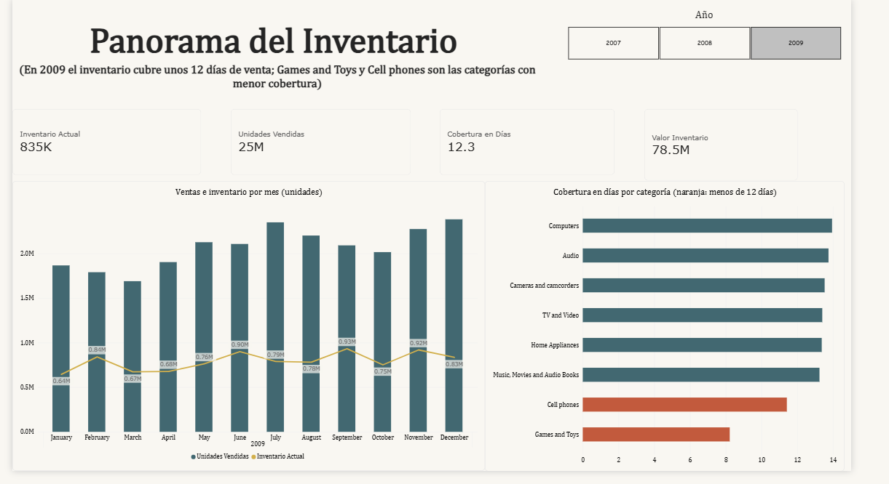
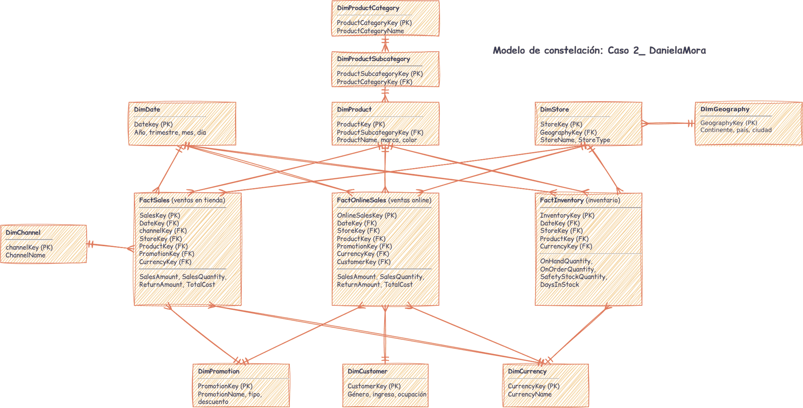

# Caso 2: ¿Dónde hay un desajuste entre inventario y ventas?

Aplicación del modelo de constelación de hechos a la base de datos ContosoRetailDW para construir un dashboard en Power BI mediante un relato visual.

**Autora:** Daniela Mora

📥 **[Descargar el archivo de Power BI (.pbix, 422 MB)](https://github.com/danielamora-a/Caso2_DM/releases/download/v1.0/Caso_2_DanielaMora.pbix)**: por su tamaño está guardado en la sección [Releases](https://github.com/danielamora-a/Caso2_DM/releases) del repositorio, no junto a los demás archivos.

## Pregunta de investigación

¿Dónde existe una discrepancia entre el inventario disponible y las ventas reales?

## Datos y herramientas

- **Base de datos:** ContosoRetailDW (base de datos de ejemplo en SQL Server)
- **SQL Server Management Studio:** exploración de tablas, llaves y rangos de fechas
- **Power BI Desktop:** modelo de constelación, medidas DAX y dashboard
- **draw.io:** diagrama del modelo

## Modelo de constelación

Tres tablas de hechos (FactSales, FactOnlineSales y FactInventory) que comparten las dimensiones de fecha, producto, tienda y moneda, con 19 relaciones de uno a muchos.

## Contenido del repositorio

| Archivo | Descripción |
|---|---|
| `Caso2_DanielaMora.pdf` | Informe del caso |
| `Modelo_constelacion_drawio.pdf` | Diagrama del modelo de constelación |
| `sql/exploracion_ContosoRetailDW.sql` | Consultas SQL utilizadas en la exploración |
| `imagenes/` | Capturas del modelo y de las 3 páginas del dashboard |
| [`Caso_2_DanielaMora.pbix`](https://github.com/danielamora-a/Caso2_DM/releases/download/v1.0/Caso_2_DanielaMora.pbix) (en Releases) | Archivo de Power BI con el modelo y el dashboard |

## Principales hallazgos (2009)

- 835 mil unidades en inventario, valoradas en 78.5 millones, con una cobertura de 12.3 días.
- Tres subcategorías están por debajo de su stock de seguridad: Movie DVD (−39,372 unidades), Boxed Games (−2,374) y Smart phones & PDAs (−204).
- Download Games es el caso más crítico, con apenas 4.6 días de cobertura.
- Un exceso de unidades no siempre se traduce en un exceso de días de venta, como muestra Cell phones Accessories.
